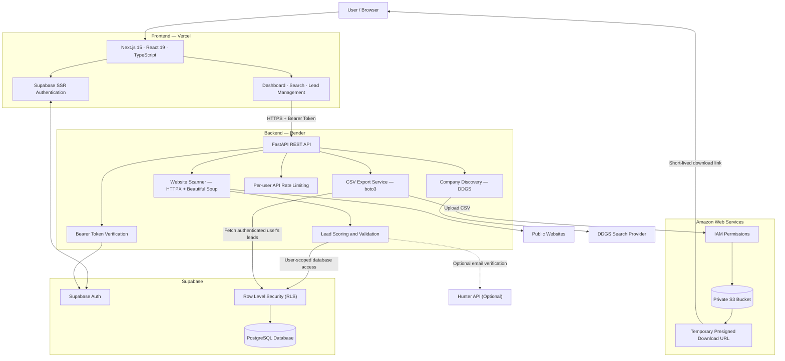

# LeadForge — B2B Lead Generation & Research Platform

Discover, research, and export qualified B2B leads using automated web research.

## 🎥 Project Walkthrough

<a href="https://drive.google.com/file/d/1nu_Mw5onq_dFlYxjQJ2W4pT-yPCZ3mtu/view" target="_blank" rel="noopener noreferrer">
  
</a>

A short demonstration of LeadForge's core features, lead discovery workflow, and export functionality. Click on the image to watch the video. Link may or may not open in a new tab, right click and open it in a new tab if you want this tab open.

## Architecture

LeadForge is a full-stack lead generation and research application. It combines a Next.js + React.js frontend, a FastAPI backend, Supabase authentication and PostgreSQL storage, and Amazon S3 for private CSV exports.

### System Architecture



### Technology Stack

| Layer | Technologies | Responsibility |
|---|---|---|
| Frontend | Next.js 15, React 19, TypeScript, Tailwind CSS, Base UI | User interface, authentication flow, lead discovery, filtering, status management, statistics, and exports |
| Backend | Python, FastAPI, Uvicorn | REST API, authentication verification, discovery, website scanning, scoring, validation, and export processing |
| Web discovery | DDGS | Find candidate company websites from industry, location, keywords, and country |
| Website extraction | HTTPX, Beautiful Soup | Fetch public HTML pages and extract company information and contact signals |
| Email validation | `email-validator`, `dnspython`, optional Hunter API | Check email syntax, DNS MX records, and optional external verification signals |
| Authentication | Supabase Auth, Supabase SSR | Email/password authentication and session management |
| Database | Supabase PostgreSQL, Row Level Security | Store and isolate user-owned lead records and associated metadata |
| Cloud object storage | Amazon S3 | Store generated CSV exports privately |
| Cloud permissions | AWS IAM | Restrict backend access to the required S3 resources |
| Frontend hosting | Vercel | Deploy and serve the Next.js application |
| Backend hosting | Render | Run the FastAPI application |

### Core Request Flows

#### 1. Authentication and authorization

1. Users register or sign in through Supabase Auth.
2. The frontend obtains the user's authenticated session and access token.
3. The frontend sends API requests to FastAPI over HTTPS with a Bearer token.
4. The backend verifies the token against Supabase Auth before allowing protected operations.
5. User-facing database queries use the authenticated user's token with the Supabase publishable key, allowing PostgreSQL Row Level Security policies to enforce data isolation.
6. The Supabase service-role key remains exclusively on the backend for privileged server-side operations.

#### 2. Lead discovery and website scanning

1. The user submits an industry, location, keywords, country, and desired result count.
2. The backend queries DDGS and returns candidate company websites, filtering duplicate domains and common social networks or directories.
3. The user reviews candidates and selects a website to scan.
4. FastAPI fetches accessible public HTML using HTTPX and Beautiful Soup.
5. The scanner extracts company names, descriptions, email addresses, phone-like strings, and social links.
6. LeadForge computes an explainable heuristic lead score based on the available company and contact signals.
7. Website reachability, email syntax, DNS MX records, and optional Hunter results contribute to data-quality and validation signals.
8. The resulting lead is saved or updated in Supabase under the authenticated user's account.

The scanner is deliberately bounded: it processes at most five pages per scan and applies an eight-second HTTP request timeout by default. It does not bypass CAPTCHAs, authentication, paywalls, or anti-bot controls.

#### 3. Lead management

The dashboard calls the protected FastAPI endpoints to retrieve and filter leads, update lead statuses, rerun validation, and load statistics. The backend uses authenticated, user-scoped database access, while RLS protects records from cross-user access.

Supported lead statuses are `new`, `reviewed`, `qualified`, and `disqualified`.

#### 4. AWS S3 CSV export

The CSV export workflow connects LeadForge to AWS without making the S3 bucket public.

1. The user clicks **Export CSV** in the frontend.
2. The frontend requests `GET /api/exports/leads` with the authenticated Supabase access token.
3. FastAPI verifies the user and retrieves that user's leads through the RLS-protected database client. The export currently includes up to 500 records.
4. The backend generates the CSV and uploads it to the private S3 bucket under a user-specific object prefix:

   `exports/{user_id}/{uuid}.csv`

5. The backend uses AWS credentials configured as Render environment variables and IAM permissions restricted to the required S3 objects.
6. S3 stores the generated file with server-side encryption using AES-256.
7. FastAPI returns a presigned download URL that expires after five minutes.
8. The browser downloads the file using that temporary URL. The bucket remains private.

The application does not need public S3 object access to provide downloads.

### API Overview

| Method | Endpoint | Purpose |
|---|---|---|
| `GET` | `/health` | Backend health check |
| `POST` | `/api/discover` | Discover candidate company websites |
| `POST` | `/api/scan` | Scan a website, score the lead, validate signals, and save the result |
| `GET` | `/api/leads` | Retrieve and filter the authenticated user's leads |
| `PATCH` | `/api/leads/{lead_id}/status` | Update a lead's status |
| `POST` | `/api/leads/{lead_id}/validate` | Rerun lead validation |
| `GET` | `/api/stats` | Retrieve lead statistics |
| `GET` | `/api/exports/leads` | Generate and upload a CSV export to S3, then return a temporary download URL |

Protected endpoints require a valid Supabase access token. The `/health` endpoint is public.

### Security and Resource Controls

- **Authentication:** Supabase access tokens are verified server-side before protected API operations.
- **Data isolation:** User-scoped database access and RLS policies restrict access to each user's records.
- **Secret management:** Privileged Supabase and AWS credentials are kept in backend environment variables and are not exposed through the frontend.
- **Private exports:** S3 Block Public Access is enabled; downloads use temporary presigned URLs.
- **Least privilege:** IAM permissions are restricted to the application's required S3 export objects.
- **Bounded scanning:** Website scans are restricted by page count and request timeout, and common private or non-public network destinations are rejected.
- **API rate limiting:** In-memory per-user limits are applied to protected endpoints to reduce repeated requests. These limits apply to a single backend process and reset when that process restarts; they are not a distributed rate-limiting system.
- **Cost awareness:** A monthly AWS budget alert is configured. A budget alert notifies the owner but does not automatically stop spending.

### Repository Structure

```text
leadforge/
├── frontend/
│   ├── src/
│   │   ├── app/
│   │   │   ├── api/
│   │   │   │   └── validate-email-domain/
│   │   │   │       └── route.ts
│   │   │   ├── dashboard/
│   │   │   │   └── page.tsx
│   │   │   ├── login/
│   │   │   │   ├── page.tsx
│   │   │   │   └── page.test.tsx
│   │   │   ├── signup/
│   │   │   │   └── page.tsx
│   │   │   ├── globals.css
│   │   │   ├── layout.tsx
│   │   │   └── page.tsx
│   │   ├── components/
│   │   │   ├── ui/                  # Reusable UI components
│   │   │   ├── auth-shell.tsx
│   │   │   ├── dashboard.tsx
│   │   │   └── dashboard.test.tsx
│   │   ├── lib/
│   │   │   ├── supabase/
│   │   │   │   ├── client.ts
│   │   │   │   └── server.ts
│   │   │   └── utils.ts
│   │   ├── test/
│   │   │   └── setup.ts
│   │   └── middleware.ts
│   ├── .env.example
│   ├── package.json
│   ├── package-lock.json
│   ├── next.config.ts
│   ├── vitest.config.ts
│   └── README.md
│
├── backend/
│   ├── api/
│   │   ├── routers/
│   │   │   ├── discovery.py
│   │   │   ├── exports.py
│   │   │   ├── health.py
│   │   │   ├── leads.py
│   │   │   ├── scans.py
│   │   │   ├── stats.py
│   │   │   └── validation.py
│   │   └── index.py                # Vercel adapter entry point
│   ├── core/
│   │   ├── config.py               # Settings and logging
│   │   ├── rate_limiter.py         # Request rate limiting
│   │   └── security.py             # Authentication and authorization
│   ├── models/
│   │   └── requests.py              # Request schemas
│   ├── repositories/
│   │   ├── email_cache_repository.py
│   │   └── lead_repository.py
│   ├── services/
│   │   ├── discovery_service.py
│   │   ├── email_verification.py
│   │   ├── export_service.py
│   │   ├── lead_scoring.py
│   │   ├── lead_validation.py
│   │   └── scanning_service.py
│   ├── tests/
│   │   ├── test_application_structure.py
│   │   ├── test_company_name.py
│   │   └── test_core_behaviors.py
│   ├── utils/
│   │   └── url_utils.py             # URL safety and normalization
│   ├── main.py                      # FastAPI application entry point
│   ├── requirements.txt
│   ├── requirements-dev.txt
│   ├── .env.example
│   ├── .coveragerc
│   ├── vercel.json
│   └── README.md
│
├── database/
│   ├── schema.sql
│   ├── migrations/
│   │   ├── 002_lead_validation.sql
│   │   ├── 003_hunter_email_verification.sql
│   │   └── 005_add_lead_ownership.sql
│   └── README.md
│
├── .gitignore
└── README.md
```

The backend follows a modular architecture: API routers handle HTTP requests, services implement business workflows, repositories isolate database operations, and core modules manage configuration, security, and rate limiting. Shared URL-processing helpers live in `utils/`.

The frontend separates Next.js routes, reusable UI components, Supabase clients, and test setup into dedicated directories.

The database/ directory contains the base PostgreSQL schema, incremental migrations, and database documentation.

```

### Deployment Architecture

- **Vercel:** Deploys the `frontend` directory and supplies the public API URL and public Supabase configuration through environment variables.
- **Render:** Deploys the `backend` directory and supplies Supabase credentials, the allowed frontend origin, and AWS S3 configuration through environment variables.
- **Supabase:** Provides authentication, PostgreSQL storage, and RLS-based data access.
- **Amazon S3:** Stores private CSV exports in the configured AWS region, `ap-south-1`.

The frontend and backend communicate through the deployed HTTPS API. The backend connects separately to Supabase and Amazon S3 as needed.

### Current Scope and Limitations

LeadForge currently implements synchronous lead discovery and scanning, authenticated lead management, validation, statistics, and private S3-backed CSV exports. Scanning is intentionally bounded, but concurrent scan scheduling, background job queues, distributed rate limiting, automatic retries, and team-based access controls are not implemented. Website search results, contact extraction, and email verification can be incomplete or affected by external provider limits.
